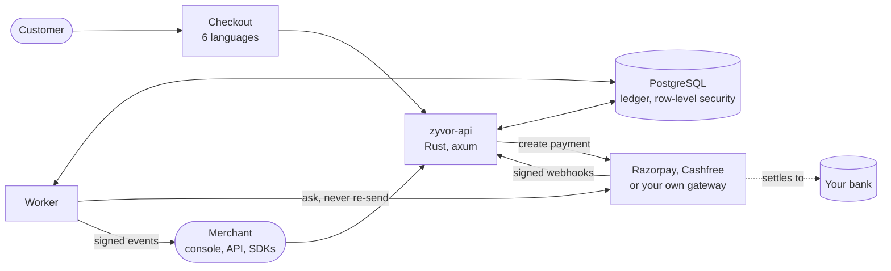
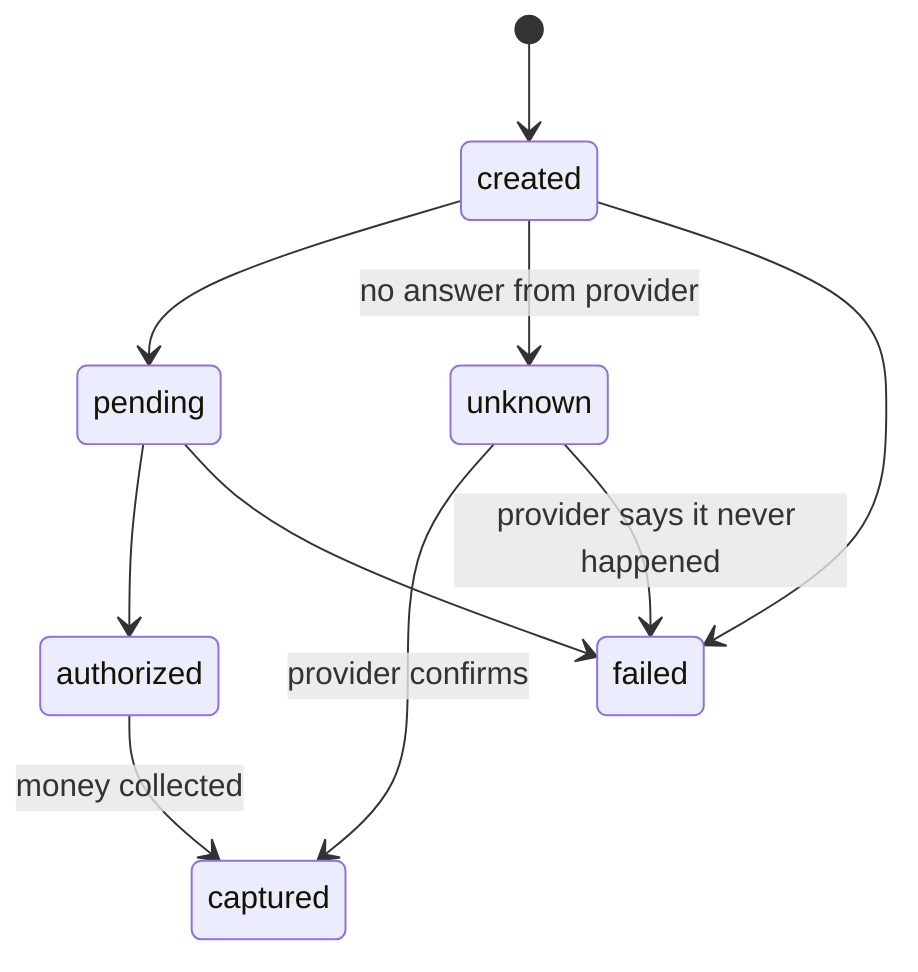

<div align="center">


# Zyvor Payments

**Payment orchestration, ledger and reconciliation for Indian businesses.**

Connect your own Razorpay and Cashfree accounts, or your own gateway. Zyvor routes, records and reconciles. Your provider settles.<br>
Rust core · PostgreSQL · Next.js checkout and console · TypeScript, Python and Go SDKs · iOS test apps

[](https://github.com/zyvorai/vayora/actions/workflows/ci.yml)
[](LICENSE)


[Website](https://zyvorai.github.io/vayora/) · [How it works](docs/zyvor/HOW_IT_WORKS.md) · [Bring your own provider](docs/zyvor/BRING_YOUR_OWN_PROVIDER.md) · [Status](docs/zyvor/STATUS.md) · [Architecture](docs/zyvor/ARCHITECTURE.md) · [Regulatory position](docs/zyvor/REGULATORY.md) · [OpenAPI](openapi/zyvor.yaml) · [All docs](docs/README.md)

</div>

> **Honest status.** Payments, ledger, reconciliation, billing, collections, disputes, payout bookkeeping, GST invoicing and a merchant console are built and tested. Providers are verified against **local simulators**; the one exception is **Cashfree UPI intent and QR, which was run against Cashfree's real sandbox** (never live). Zyvor does not hold or move customers' money, does not move money to vendors, does not file GST returns, and is **not a licensed payment service**. [STATUS.md](docs/zyvor/STATUS.md) and [IMPLEMENTATION_STATUS.md](docs/zyvor/IMPLEMENTATION_STATUS.md) list every gap; [MARKET.md](docs/zyvor/MARKET.md) compares it with Indian gateways.

## What it does
- **Never double-charges.** Idempotent writes; an uncertain provider outcome becomes `unknown` and blocks any new attempt, through any provider, until it is resolved. The system asks the provider; it never re-sends.
- **Explains every rupee.** `GET /v1/settlements/{id}/explain` lists payments, refunds, fees, adjustments, the bank match and why the net is what it is. Anything unexplained becomes an assignable case.
- **Keeps books you can audit.** Append-only double-entry ledger, balanced per currency by code and by a database constraint; corrections are reversals.
- **Routes with receipts.** A capability matrix, rules and configured fees choose a provider, and the decision records every provider considered and why.
- **Measures real cost.** Effective cost by provider and method from observed settlement deductions, with suggestions that cite their evidence and never change anything on their own.
- **Isolates tenants.** Row-level security enforced in tests as a non-superuser role; test and live are separate tenants.
- **Bills and collects.** Plans, subscriptions, usage, proration, milestones, instalment plans, credit notes, GST tax invoices (CGST/SGST/IGST, GSTIN-checked, GSTR-1 style summary), ageing, promises to pay, reminders you approve, optional AI-worded drafts a person reviews, and disputes that hold the money.
- **Collects on a schedule.** UPI AutoPay mandates: the payer approves once, the merchant schedules debits, each announced ahead; a subscription with a mandate collects its own invoices. Simulator only today: no real provider adapter yet, and the notice and limit rules are configurable but not verified against NPCI.
- **Takes payments your way.** Payment links with QR codes, coupons and a payer-covered fee; UPI intent and QR checkout (no UPI ID to type); marketplace splits to vendors with balances; bulk and maker-checker payouts (bookkeeping: you pay from your bank); risk limits; checkout in six languages (translations awaiting native review).
- **Runs a shop floor.** Branches and counters (a counter's QR, optionally with a payer-typed amount, ties payments to it), branch-limited API keys, cash entries, an end-of-day closing a second person signs off, a per-payment timeline in plain words, and merchant onboarding records reviewed by a second person. Records and prompts only: Zyvor does not hold funds, verify identity or move cash.
- **Is hard to abuse.** Per-key and per-address rate limits, API keys with expiry, address allow-lists and rotation, SSRF-guarded webhooks, a rotatable master key, a tamper-evident audit chain, named console users with TOTP and roles, a default-deny network policy, and supply-chain scanning in CI. See the [threat model](docs/zyvor/THREAT_MODEL.md).

## How it works

Your own provider account collects the money. Zyvor decides where a payment goes, writes every step into an append-only ledger, and checks that what the provider settled matches what was paid.



**What a customer sees:** scan a QR or open a link, pick UPI or card in their own language, approve in their UPI app, see "Payment received".
**What the server does:** saves the attempt first, calls the provider outside any database transaction, accepts duplicated and out-of-order webhooks safely, posts to the ledger exactly once, and tells the merchant with a signed webhook.



### Why a provider, and bring your own
Zyvor never holds money, so a payment provider has to collect and settle it. Razorpay and Cashfree are two adapters behind one `Provider` trait; a third, `custom`, lets you point Zyvor at **your own gateway or bank API** over a small JSON contract, with no fork. Routing, the state machine, the ledger and reconciliation are unchanged. Swapping the provider does not make a deployment licensed: whoever collects the money must be authorised to.

[Why and how to swap](docs/zyvor/BRING_YOUR_OWN_PROVIDER.md) · [HTTP contract](docs/zyvor/PROVIDER_CONTRACT.md) · [template adapter](crates/zyvor-providers/src/custom.rs) · [Cashfree sandbox setup](docs/zyvor/PARTNER_SETUP.md)

The full walkthrough, with a diagram for each part, is in **[docs/zyvor/HOW_IT_WORKS.md](docs/zyvor/HOW_IT_WORKS.md)**. The component map and invariants are in [ARCHITECTURE.md](docs/zyvor/ARCHITECTURE.md).

## Try the sandbox (simulated providers, no real money)
```sh
# needs a local Postgres and an EMPTY database
OWNER_URL=postgres://you@localhost:5432/zyvor_sandbox ./scripts/zyvor-sandbox.sh
ZYVOR_API_URL=http://localhost:8080 pnpm --filter @zyvor/checkout dev    # then open the printed checkout URL
# the merchant console: see apps/zyvor-console/.env.example, then `pnpm --filter @zyvor/console dev`
```
```sh
cargo test --workspace      # the API tests run against real Postgres (set DATABASE_URL to a superuser connection)
pnpm -r build && pnpm -r test
```
Deploy: `deploy/zyvor/k3s/` (verified on a single-node k3s sandbox, with HTTPS in front; see its README), `deploy/zyvor/docker-compose.yml` and `deploy/zyvor/helm/zyvor` (both validate; neither has been run here).

```ts
import { Zyvor } from "@zyvor/node";
const z = new Zyvor({ apiKey: process.env.ZYVOR_API_KEY! });
const intent = await z.intents.create({ amountMinor: 249900, externalRef: "FEE-STU-2231-T2" });
// give intent.client_secret to the browser; it can pay this one intent and nothing else
```

Runnable examples for a school's fee schedule, a clinic's GST billing and deposits, a shop counter and a marketplace's splits and payouts are in [`examples/`](examples/README.md).

## iOS test apps
Two SwiftUI apps in [`apps/ios`](apps/ios/README.md) let you test the whole loop on real iPhones against the simulator, with **no real money**: **Vayora Pay** (a payer: scan a QR, slide to pay, PIN, receipt) and **Vayora Merchant** (a counter keypad that shows a payment QR, a Today dashboard, refunds). The server side is one route, `POST /v1/sim/pay`, off unless `ZYVOR_SIM_PAYER=1`. They are not bank-linked UPI apps: a real consumer UPI app needs NPCI TPAP approval and a sponsor bank. Pay also has test-mode payees, send, split a bill and bill reminders; those person-to-person items are recorded on the phone and never reach Zyvor's ledger.

## Repository layout

| Path | What it is |
|---|---|
| `crates/zyvor-api` | The axum API and the worker: payments, ledger posting, reconciliation, billing, collections, console API |
| `crates/zyvor-core`, `zyvor-ledger` | Domain types (`Money` in minor units, ids) and the double-entry ledger |
| `crates/zyvor-providers` | Provider adapters: Razorpay, Cashfree, `custom`, and the in-process simulator |
| `crates/zyvor-provider-mock` | A local mock provider for the sandbox |
| `apps/zyvor-checkout` | Next.js hosted checkout, six languages |
| `apps/zyvor-console` | Merchant console: payments, links, refunds, payouts, reconciliation, collections, billing, disputes, webhooks, people |
| `apps/ios` | The Vayora Pay and Vayora Merchant test apps, and `VayoraKit` / `VayoraUI` |
| `packages/zyvor-node`, `sdks/python`, `sdks/go` | SDKs |
| `openapi/zyvor.yaml` | The API spec; a test fails if a route is undocumented |
| `deploy/zyvor/` | Dockerfiles, Compose, Helm, k3s and Envoy assets |
| `examples/` | Runnable examples |
| `site/` | The GitHub Pages site |
| `docs/` | Documentation: see the [index](docs/README.md) |

## Principles
- Money is integer minor units (paise), never floats.
- Every mutating endpoint takes an `Idempotency-Key`.
- Ledger entries are immutable; corrections are new entries.
- A payment is paid only after a verified provider result, never because a QR was shown or an app was opened.

## Regulatory notice
Publishing code is free; moving money in India is not. Running this in production needs, at minimum, authorisation from RBI as a payment aggregator (or a licensed partner), a bank and provider agreements, and a review of data-localisation and DPDP obligations. See [REGULATORY.md](docs/zyvor/REGULATORY.md).

Licensed under [Apache-2.0](LICENSE). Security issues: [SECURITY.md](SECURITY.md). Contributing: [CONTRIBUTING.md](CONTRIBUTING.md).
