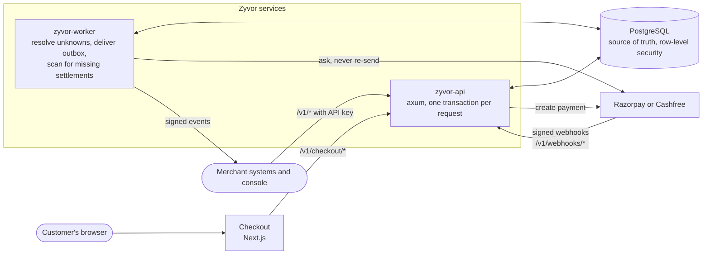

# Zyvor Payments architecture

New to the system? Start with [HOW_IT_WORKS.md](HOW_IT_WORKS.md): the customer's journey, the server's rules and the worker's loop, each with a diagram.

## Money-flow model (read this first)
Zyvor **does not hold funds**. The merchant's own provider accounts collect and settle; Zyvor records, routes, reconciles and explains. The ledger is an accounting record: `provider_receivable:<provider>` is what a provider owes the merchant, never a claim that Zyvor holds money. See [REGULATORY.md](REGULATORY.md).

## Invariants and where they are enforced
| Invariant | Enforced by |
|---|---|
| A repeated request never repeats the operation | `idempotency_keys` row written in the request's transaction; replay returns the resource's current state |
| An uncertain provider outcome is never retried elsewhere | attempt is persisted *before* the provider call; `unknown` blocks further attempts on the intent; the worker only *asks* the provider |
| State never regresses | `state_machine::attempt_transition` (pure, unit-tested); the single apply function locks the attempt row |
| A capture posts to the ledger once | unique `(tenant, reference)` on ledger transactions + the transition applies once |
| Debits equal credits per currency | `Transaction::new` and a deferred constraint trigger on `ledger_entries` |
| History is immutable | triggers reject UPDATE/DELETE on ledger, audit and allocations; corrections are reversals |
| Refunds never exceed the payment | reservation counter locked per attempt + a CHECK constraint |
| Tenants cannot see each other | every table has `tenant_id` + row-level security keyed on `zyvor.tenant_id`; the service must run as a non-superuser role |
| Provider secrets are never readable | AES-256-GCM, key from `ZYVOR_MASTER_KEY`, never returned by any endpoint |

## Provider calls happen outside database transactions
Persist → call provider → record result in a second transaction. A crash in between leaves an attempt in `created`; the worker asks the provider (by our attempt id) and adopts the truth, or marks it failed if the provider never saw it.

## Operating notes
- Run migrations with the schema owner (`ZYVOR_MIGRATE_DATABASE_URL`) and serve as `zyvor_app`, a non-superuser role (`deploy/zyvor/sql/roles.sql`). A superuser bypasses row-level security.
- Webhook endpoints are per tenant and provider: `/v1/webhooks/{provider}/{tenant_id}`.
- Workers can be scaled out: delivery uses `FOR UPDATE SKIP LOCKED`.
