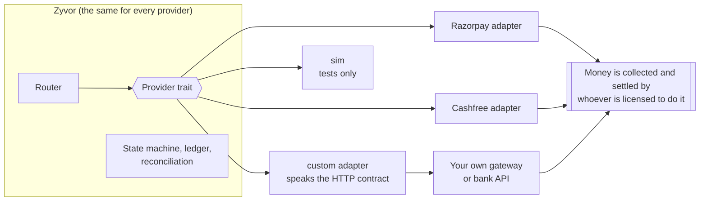

# Why a provider, and how to bring your own

Zyvor Payments needs a **payment provider** by design, and Razorpay and Cashfree are only two of the ways to be one. This page explains why a provider is required, what you can swap in instead, and exactly how.

## Why a provider is required

Zyvor **does not hold money**. It never receives, holds or pays out customer funds. That is a deliberate choice and it is the reason the platform can ship as open source without being a payment aggregator ([REGULATORY.md](REGULATORY.md)). It means someone else has to do the part Zyvor will not:

| Someone has to... | Why Zyvor does not |
|---|---|
| Collect the customer's money over UPI, cards or netbanking | Collecting on behalf of merchants is a regulated activity. Zyvor is not licensed for it |
| Settle that money to your bank | Zyvor never touches funds, so it cannot settle them |
| Keep card data out of your systems | Hosted checkout keeps card data with the provider. No card data touches Zyvor |
| Handle KYC and chargebacks at the rail | Zyvor records disputes and holds the money in its books, but the rail decides them |

What Zyvor adds on top of whoever does that: routing with receipts, a ledger you can audit, exactly-once payments, reconciliation, billing and collections.



The router, state machine, ledger and reconciliation only see the trait's normalised types. A new adapter inherits idempotency, `unknown`-outcome handling, ledger posting and reconciliation without touching any of them.

## What you can swap in

Anything that can accept a payment request and report back, as long as the party that **actually collects the money is authorised to**:

- another licensed gateway or payment aggregator
- a bank or acquirer API
- your own gateway, if your company holds the licence
- a thin wrapper in front of any of the above that speaks Zyvor's HTTP contract

What swapping does **not** do: make you licensed. Replacing Razorpay moves the responsibility, not removes it. Whether a deployment needs its own authorisation is a question for counsel ([REGULATORY.md](REGULATORY.md)). The `sim` provider is refused in a live environment.

## Two ways to bring your own

### A. Point the generic adapter at your gateway (no Rust)

Run a service that speaks the JSON contract in [PROVIDER_CONTRACT.md](PROVIDER_CONTRACT.md), then register it:

```sh
curl -X POST $ZYVOR/v1/provider_accounts \
  -H "Authorization: Bearer $ADMIN_KEY" -H "Content-Type: application/json" \
  -d '{
    "provider": "custom",
    "base_url": "https://gateway.example.com",
    "credentials": { "api_key": "..." },
    "webhook_secret": "..."
  }'
```

`base_url` must be a public `https` address (private networks and internal names are refused, the same guard as outbound webhooks). Your gateway posts events to `/v1/webhooks/custom/{tenant_id}`, signed as the contract describes. The router uses the capabilities the adapter declares, so declare only what your gateway really supports.

### B. Write a native adapter (Rust)

Copy [`crates/zyvor-providers/src/custom.rs`](../../crates/zyvor-providers/src/custom.rs), which is written as the template, and:

1. Implement `Provider` (`initiate`, `capture`, `fetch_payment`, `refund`, `fetch_refund`, `fetch_settlements`, `verify_webhook`, `capabilities`) in a new module and `pub mod` it in `crates/zyvor-providers/src/lib.rs`.
2. Build it from the tenant's encrypted credentials in `registry::load` (`crates/zyvor-api/src/registry.rs`).
3. Add its name and required credential keys in `create_provider_account` (`crates/zyvor-api/src/admin.rs`).
4. Allow the name in the database: a migration that updates the `provider_accounts_provider_check` constraint (see `0027_custom_provider.sql`).
5. Add it to the `provider` enum in `openapi/zyvor.yaml`.
6. Test it against a local stub, as `crates/zyvor-providers/tests/custom.rs` does.

There is no plugin loader: adapters are compiled in.

## The rules every adapter must keep

| Rule | Why |
|---|---|
| A failure that left no trace is `Rejected`. An outcome that cannot be known (timeout, 5xx, dropped connection) is `Uncertain` | An `Uncertain` payment is never retried through another provider. It blocks new attempts until resolved |
| Use our attempt id as your reference, and let `fetch_payment` find it again | A lost response is resolved by asking, never by sending again. "Never seen" is a definite `failed` |
| Amounts are integer minor units, never floats | No rounding surprises between systems |
| Verify the signature and the age of every webhook before reading it | Duplicated, forged and replayed events must do nothing |
| Give every webhook a unique `event_id` | Delivery is at least once, so Zyvor de-duplicates on it |
| Settlements are signed from the merchant's view: payments +, refunds -, fees - | So the items add up to the net and reconciliation can explain every rupee |

## What you inherit, and what stays yours

You inherit: routing and its recorded reasons, exactly-once payments, the `unknown`-outcome worker, the ledger, signed merchant webhooks, reconciliation and cost analytics.

Still yours: the licence for whatever collects the money, PCI scope for any page that embeds provider fields, KYC with your provider, data-localisation and DPDP obligations, and the provider's own terms.

Adapters here are verified against local simulators and stubs (and the Cashfree UPI intent and QR path against Cashfree's sandbox), never a live gateway ([STATUS.md](STATUS.md)). Test yours against your provider's sandbox before you trust it.
