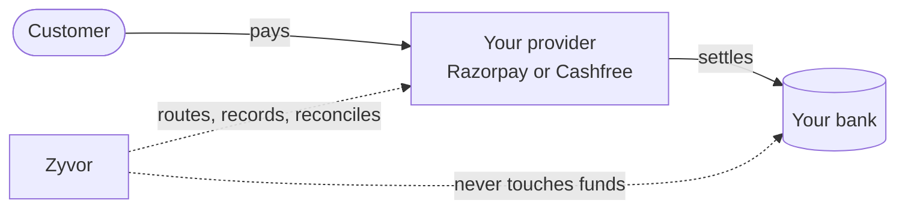
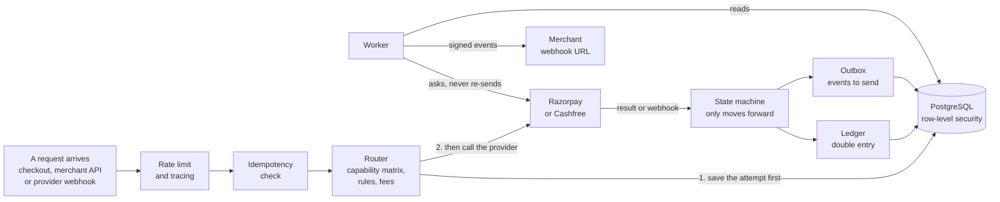
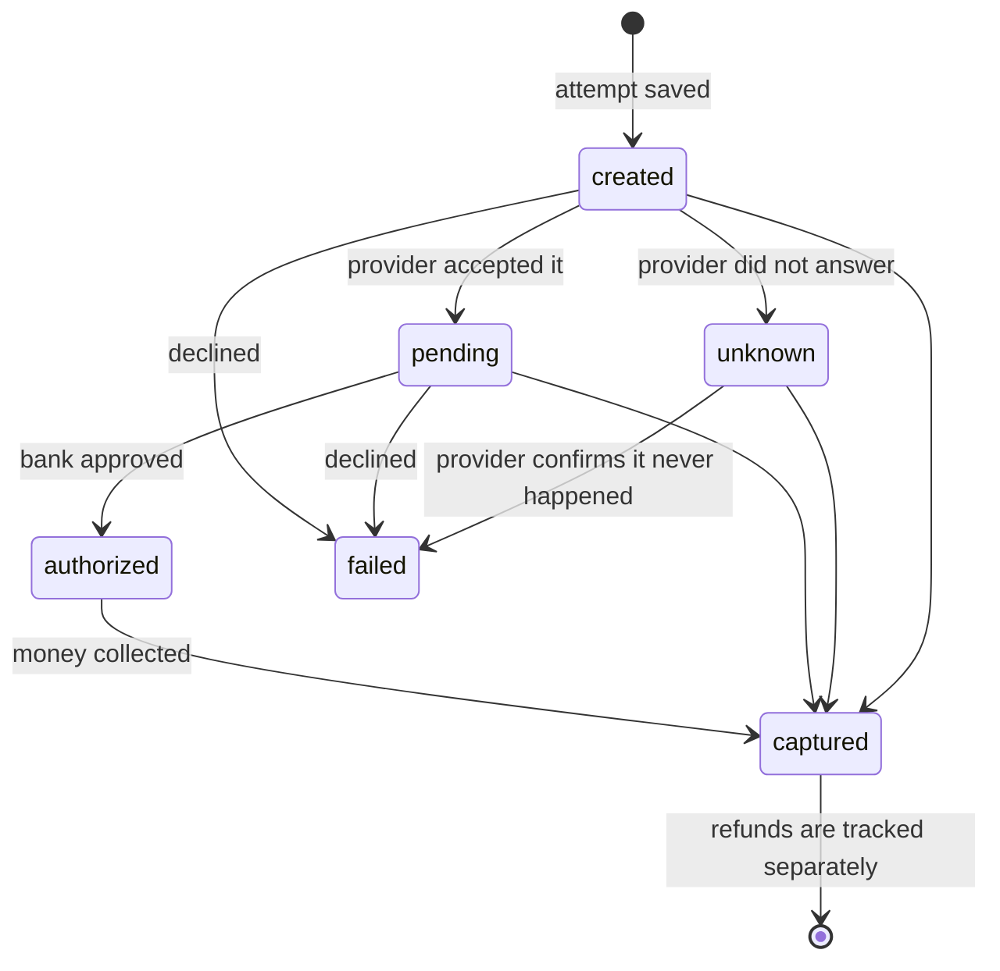
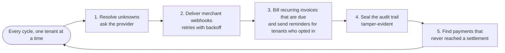
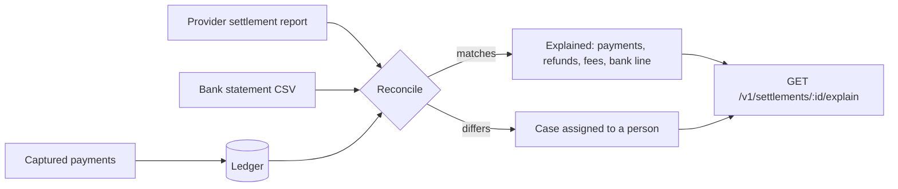

# How Zyvor Payments works

Three views of the same system: what a **customer** sees when they pay, what the **server** does behind that tap, and how the **books** stay right afterwards. Every diagram below is drawn from the code in this repository, and every claim links to where it is enforced. Providers are verified against local simulators, and Cashfree UPI intent and QR also against Cashfree's sandbox; see [STATUS.md](STATUS.md).

## The one idea to hold on to

Zyvor **does not hold money**. Your own Razorpay or Cashfree account collects the payment and settles it to your bank. Razorpay and Cashfree are just two adapters; you can bring your own gateway instead ([BRING_YOUR_OWN_PROVIDER.md](BRING_YOUR_OWN_PROVIDER.md)). Zyvor decides where a payment goes, records every step in an append-only ledger, and checks that what the provider settled matches what was paid. See [REGULATORY.md](REGULATORY.md).



## 1. A customer pays (the common-person view)

A parent paying a school fee, a patient paying at a clinic, a shopper at a counter. They never see Zyvor's name unless the merchant shows it.

```mermaid
sequenceDiagram
  autonumber
  actor Payer as Customer
  participant Link as Payment link or counter QR
  participant Chk as Checkout page
  participant API as Zyvor API
  participant Prov as Provider
  participant Mer as Merchant system

  Payer->>Link: scans a QR or opens a link
  Link->>Chk: opens in their language
  Chk->>API: load the amount and merchant name
  API-->>Chk: ₹ amount, methods allowed
  Payer->>Chk: picks UPI and enters their UPI ID
  Chk->>API: pay (one idempotency key per tap)
  API->>API: save the attempt, choose a provider
  API->>Prov: create the payment
  Prov-->>Payer: UPI app asks for approval
  Payer->>Prov: approves with their PIN
  Prov-->>API: signed webhook: paid
  API->>API: record once in the ledger
  API-->>Mer: signed webhook: payment captured
  Chk->>API: keeps checking the status
  API-->>Chk: paid
  Chk-->>Payer: "Payment received"
```

What makes this safe for the person paying:

| Moment | What happens | Why it matters |
|---|---|---|
| They tap Pay twice | Same idempotency key, same attempt | Charged once, never twice |
| Their network drops mid-payment | The page reloads and asks the server what happened | They see the true state, not a guess |
| The provider is slow to answer | The attempt becomes `unknown` and blocks any new attempt | No second charge through another provider |
| They paid but closed the page | The provider's webhook still arrives | The merchant is told, the receipt is recorded |
| They need help in their own language | English, हिन्दी, मराठी, தமிழ், తెలుగు, বাংলা | Checkout picks the saved or browser language (translations await native review) |

The checkout page never holds an API key. It can pay the one intent it was opened for, and nothing else, using a one-time client secret ([`checkout.rs`](../../crates/zyvor-api/src/checkout.rs)).

## 2. The server (what happens behind the tap)




### The rules the server will not break

| Rule | How it is enforced |
|---|---|
| A repeated request never repeats the work | An `idempotency_keys` row is written in the same database transaction as the work |
| An uncertain outcome is never retried elsewhere | The attempt is saved **before** the provider is called; `unknown` blocks further attempts |
| State never goes backwards | One pure function, `attempt_transition`, decides every move and is unit-tested |
| Money always wins | A capture is accepted from any non-captured state, even after `failed`, and is flagged for review |
| A capture reaches the ledger once | Unique `(tenant, reference)` on ledger transactions |
| Debits equal credits | Checked in code and by a database constraint; corrections are reversals |
| Tenants cannot see each other | Row-level security on every table, tested as a non-superuser role |
| Provider secrets are unreadable | AES-256-GCM with a key from `ZYVOR_MASTER_KEY`; no endpoint returns them |

### A payment's life



`captured` is the only state that moves money and it is never left. `failed` is final unless the provider later says money arrived. Webhooks come in duplicated and out of order, so every event goes through the same function and the same rules ([`state_machine.rs`](../../crates/zyvor-api/src/state_machine.rs)).

### The worker (what keeps running when nobody is paying)



Each job runs inside one tenant's scope, so a job can never touch another tenant's rows. Delivery uses `FOR UPDATE SKIP LOCKED`, so you can run more workers ([`worker.rs`](../../crates/zyvor-api/src/worker.rs)).

## 3. Afterwards: the books



`GET /v1/settlements/{id}/explain` lists the payments, refunds, fees and adjustments inside a settlement, the bank match, and why the net is what it is. Anything unexplained becomes an assignable case, never a silent difference.

## Where to look in the code

| Concern | Path |
|---|---|
| Public checkout and payment links | `crates/zyvor-api/src/checkout.rs`, `payment_links.rs`, `apps/zyvor-checkout/` |
| Payments, attempts, refunds | `payments.rs`, `refunds.rs`, `state_machine.rs` |
| Provider webhooks in | `webhooks_in.rs` |
| Merchant webhooks out | `outbox.rs`, `worker.rs` |
| Ledger and reconciliation | `crates/zyvor-ledger/`, `recon.rs`, `cases.rs` |
| Providers and simulator | `crates/zyvor-providers/`, `crates/zyvor-provider-mock/` |
| Tenancy and security | `tenant.rs`, `auth.rs`, `ratelimit.rs`, `ssrf.rs`, `crypto.rs`, `audit.rs` |
