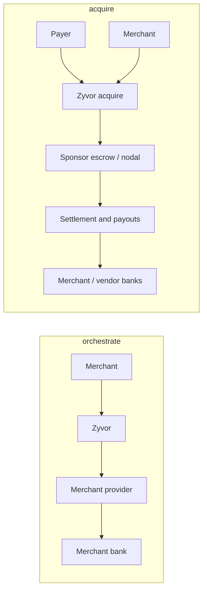

# Regulatory position (not legal advice)

Zyvor supports two money modes. **Which mode a deployment runs in changes whether Zyvor (or its sponsor) custody funds.** Counsel must review the actual fund-flow diagram for that deployment before launch. This document is not legal advice.

## Money modes

| Mode | Who collects and settles | Zyvor's role | Licence posture |
|---|---|---|---|
| **`orchestrate`** (default, as historically built) | Merchant's own Razorpay / Cashfree / custom provider | Routes, ledger, recon, billing. Never receives customer funds. | Not a payment aggregator by design of the flow |
| **`acquire`** | Licensed sponsor PA / bank PSP (white-label), later own PA if authorised | Merchant-facing PG; posts **custody** ledger accounts; settles and pays out via sponsor rails | Requires a licensed party on the fund path; own RBI PA / NPCI TPAP are separate applications |

**Hard rule:** no live `acquire` traffic without (1) a signed fund-flow diagram reviewed by counsel, and (2) a sponsor LOI or own authorisation. Sandbox may exercise acquire ledger paths against simulators only.

Things every deployment still needs regardless of mode: PCI-DSS scoping for any page that embeds card fields, India data-localisation review for Postgres, DPDP Act obligations, CERT-In incident reporting ([docs/compliance/CERT_IN_RUNBOOK.md](../compliance/CERT_IN_RUNBOOK.md)), and the providers' / sponsor's own terms.

## Target fund-flow freeze (acquire)

Until counsel and a sponsor sign off, treat this as the **intended** acquire flow (update this section when the LOI lands):

1. Payer pays via UPI/card/netbanking through the **sponsor** collection rail.
2. Funds land in the **sponsor escrow / nodal** account (not Zyvor's operating account).
3. Zyvor ledger posts `escrow:*` / `merchant_payable:*` / `vendor_payable:*` (accounting of custody under the licensed party).
4. Settlement job (T+0 / T+1) instructs the sponsor payout rail (IMPS/NEFT/UPI) to merchant and vendor bank accounts.
5. Bank statements for the escrow account are reconciled in Zyvor; unexplained gaps become cases.

**Exit criteria for go-live:** counsel memo + sponsor LOI attached to the operator's compliance pack; net-worth / capital plan for eventual own RBI PA; named PMLA KYC/AML program owner.

See [docs/compliance/OWN_LICENCES.md](../compliance/OWN_LICENCES.md) for the parallel RBI PA and NPCI TPAP application track.

## Automated onboarding checks (simulator only)

`ZYVOR_KYC_PROVIDER=simulator` turns on identity and bank checks during merchant onboarding and lets a clean submission be approved without a person. **The simulator verifies nothing about a real business**: it answers from fixed patterns (for example a PAN ending in `X` is "not found") so the flow can be built and tested. It logs a warning at startup. Never enable it for live merchants. With it off, which is the default, nothing is checked and a second person approves every submission.

In **`orchestrate`** mode Zyvor still does not perform KYC for a regulator: it uses a verification vendor and a reviewer for live access. In **`acquire`** mode the operator (or sponsor) must run PA-grade merchant due diligence — see [docs/compliance/KYC_AML_ACQUIRE.md](../compliance/KYC_AML_ACQUIRE.md). Before any real provider is added: choose a licensed verification vendor, agree retention, update this document, and have a person review the auto-approve rules in `crates/zyvor-api/src/kyc.rs` (`decide`). The checks store only an outcome and a short reason; the full PAN and account number are not kept.

## Cashfree Secure ID as the verification partner

`ZYVOR_KYC_PROVIDER=cashfree` sends a merchant's PAN, name, bank account number, IFSC and GSTIN to Cashfree Secure ID to
check them (`docs/zyvor/KYC_CASHFREE.md`). Zyvor keeps only each check's outcome and a short reason. Zyvor is still not
the party that verifies identity for a regulator in orchestrate mode: it uses a vendor, and a Zyvor reviewer makes the live-mode decision.
Before turning it on for real merchants: agree the vendor terms with Cashfree, decide how consent to the check is
captured and shown to the merchant (the Onboarding page says the details are checked with a verification partner),
and set a retention rule for the check records. The simulator is for test environments only.

## UPI AutoPay mandates: assumptions to verify before any live use
Zyvor's mandate code enforces rules that came from provider documents and articles, **not from NPCI's circulars**, and those sources disagree on details. Treat each as an assumption to confirm with your provider / sponsor and the current NPCI and RBI circulars before live AutoPay.

| Assumption | What the sources say | How the code treats it |
|---|---|---|
| The payer is told before each debit | Vendor documents describe a notice at least 24 hours ahead (some providers send it earlier); auto-replenishment for FASTag and RuPay NCMC is reported as exempt | `ZYVOR_MANDATE_NOTICE_HOURS`, default 24. Zyvor emits `mandate.debit_notified` and refuses a debit whose notice is younger than the window. **Zyvor does not message the payer**; the merchant or the provider must |
| An authentication step at registration | One source says registration needs extra authentication; NPCI's RuPay AutoPay circular covers RuPay, not all UPI | The provider performs it; Zyvor records the mandate only once the provider reports it active |
| A per-debit ceiling | Cashfree's documents give ₹15,000 up to ₹1,00,000 depending on authentication; other articles give ₹15,000 or ₹1,00,000 for some categories | `ZYVOR_MANDATE_MAX_MINOR`, default ₹15,000 (1,500,000 paise); a mandate above it is refused at creation |
| The payer can revoke at any time | Stated consistently | A payer's revoke is learned on refresh and stops every debit not yet sent; a debit already in flight is left to the provider |
| Frequency limits | Not confirmed by the sources | Zyvor allows at most one debit per period of the mandate's frequency and never two on one day |

In orchestrate mode the provider debits and settles. In acquire mode the sponsor UPI rail debits into escrow. Consent records, the notice itself and any licence remain the merchant's, the operator's and the sponsor's responsibility. Sources read: Cashfree Subscriptions documentation, Razorpay recurring-payments documentation, vendor explainers on UPI AutoPay.
